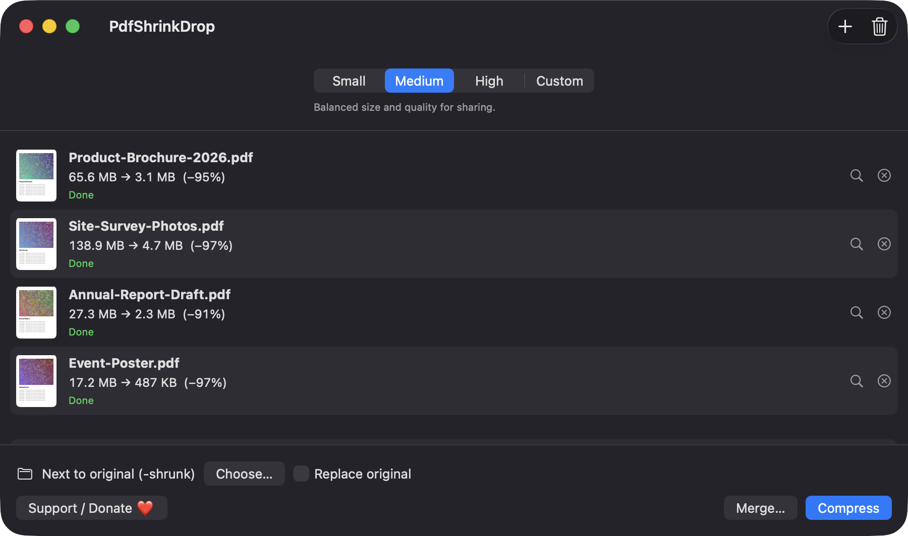
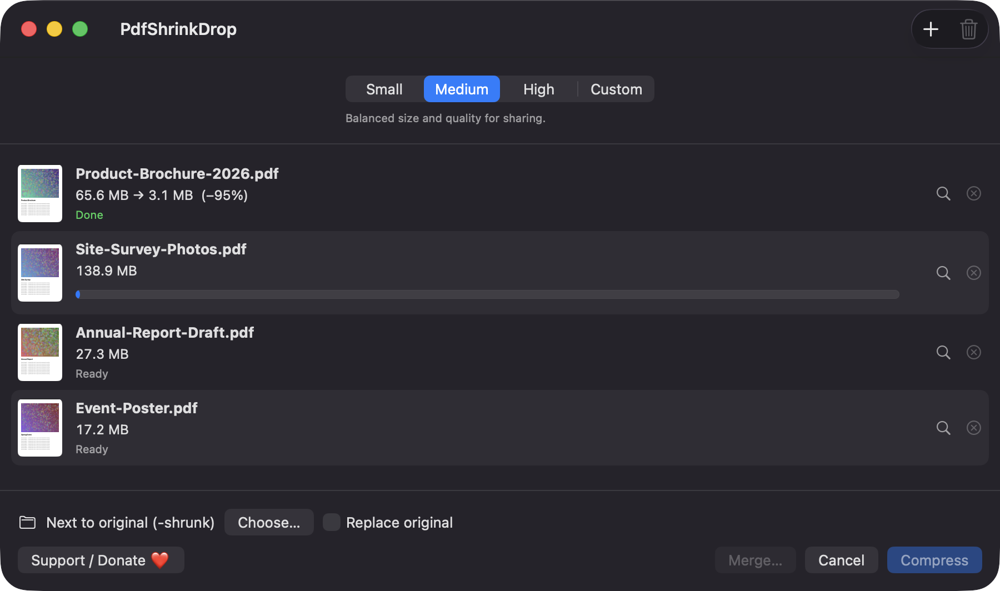
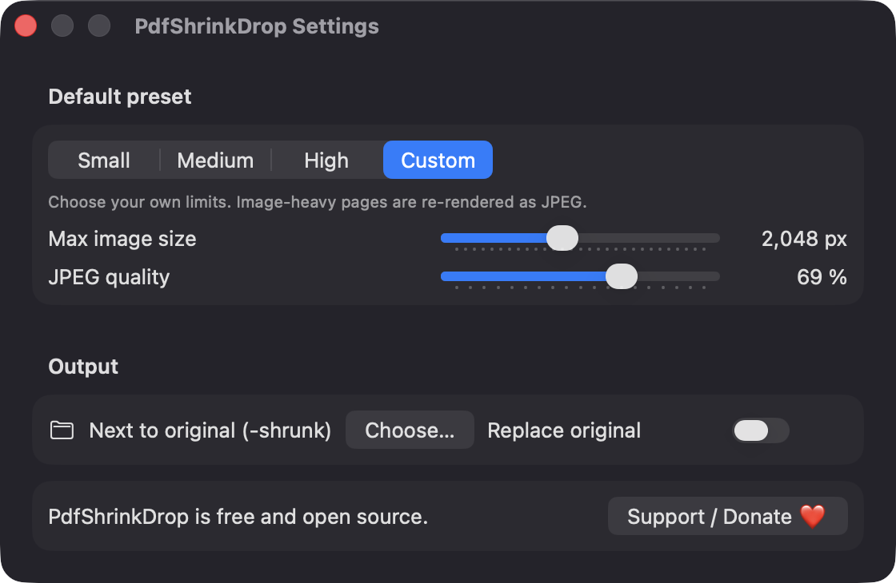

# PdfShrinkDrop

**🌐 Website:** [turhe123.github.io/pdf-shrink-drop](https://turhe123.github.io/pdf-shrink-drop/)

Drop big PDFs onto the window or Dock icon and get smaller copies with a size preset and before and after sizes.


## Why

PdfShrinkDrop is a free, open-source, 100% native, backend-free alternative to paid utilities in the *Files & Conversion* category. It was inspired by PDF Squeezer ($14.99 one-time), a well-regarded app that solves the everyday problem of PDFs that are too big to email or upload. PdfShrinkDrop covers the core of that job with plain Apple frameworks: no accounts, no servers, nothing leaves your Mac.

## Features

- **Drag and drop** one or many PDFs onto the window, or onto the app's Dock icon. You can also use **File → Open PDFs…** (⌘O) or click the empty drop area. Files that are not PDFs are skipped and duplicates are ignored.
- **Presets**: Small (screen reading), Medium (general sharing), High (print quality). Each sets a maximum image dimension and JPEG quality (1024 px / 50%, 1600 px / 65%, 2600 px / 82%).
- **Custom** preset with two sliders: max image size (512–4096 px) and JPEG quality (10–100%).
- **Before and after sizes** for every file, with the percentage saved and a status per row.
- **Thumbnails** of page one and a **progress bar** per file, plus a *Reveal in Finder* button.
- **Output options**: save next to the original with a `-shrunk` suffix (default), or into a folder you choose.
- **Replace original** (off by default): the original is moved to the Trash first, then the smaller file takes its place.
- **Merge…** joins the files in the list into a single PDF, in list order, via a save panel.
- **Already optimal**: if the result would not be smaller, the original is kept and the row says so.
- **Password-protected PDFs** show a locked status with an *Unlock…* prompt.
- **Corrupted files** get an error row instead of stopping the batch.
- **Metadata** (title, author, subject, creator, keywords) is carried over on the Custom route.
- **Cancel** stops the current job; work is done in a scratch folder so partial output is discarded, and finished files are moved into place atomically.
- Compress with ⌘↩. A Settings window reuses the same controls, and your choices are remembered.
- A visible **Support / Donate ❤️** button.

### How it compresses

- **Small / Medium / High** write the document through a Quartz filter (a "Reduce File Size"-style filter built from the preset's image size and JPEG quality). If that route fails, the app falls back to the page-by-page route.
- **Custom** goes page by page: text-rich and light pages are copied as vectors, while image-heavy pages are re-rendered as downsampled JPEGs, and only when that is clearly smaller.
- Encrypted documents are always processed page by page.

## Screenshots

<p align="center"></p>

<p align="center"><em>Four image-heavy PDFs shrunk with the Medium preset, each row showing its thumbnail, before and after size and the percentage saved.</em></p>

<p align="center"></p>

<p align="center"><em>A batch in progress: finished files show their savings while the current file shows a progress bar and Cancel is available.</em></p>

<p align="center"></p>

<p align="center"><em>Settings with the Custom preset, offering sliders for max image size and JPEG quality plus output folder and Replace original options.</em></p>

## Install

1. Download `PdfShrinkDrop-macOS.zip` from the [latest release](https://github.com/turhe123/pdf-shrink-drop/releases/latest).
2. Unzip it and move `PdfShrinkDrop.app` to `/Applications`.
3. Because the app is open source and not notarized, remove the quarantine attribute:

   ```bash
   xattr -cr /Applications/PdfShrinkDrop.app
   ```

4. The first time, right-click the app and choose **Open**.

Requires macOS 14.0 or later.

## Build from source

You need Xcode with the macOS SDK and [XcodeGen](https://github.com/yonaskolb/XcodeGen).

```bash
brew install xcodegen
xcodegen generate
xcodebuild -project PdfShrinkDrop.xcodeproj -scheme PdfShrinkDrop -configuration Release -derivedDataPath ./build build
```

The app is produced at `build/Build/Products/Release/PdfShrinkDrop.app`.

## Permissions

PdfShrinkDrop does not ask for any special system permission: no Accessibility, no Screen Recording, no Microphone, no Camera, no Contacts or Location. It is not sandboxed and does not request entitlements.

- **File access**: it only reads the PDFs you drop or choose, and writes to the output location you pick (next to the original by default). macOS may show its usual prompt the first time it touches a protected folder such as Desktop or Documents.
- **Trash**: with *Replace original* on, the original is moved to the Trash.
- **Network**: none. The only outside action is opening the Ko-fi page in your browser when you click the Support button.

## Built with AI

PdfShrinkDrop was written by [Claude Code](https://claude.com/claude-code) inside an automated pipeline, from a plain-English spec. No code, binaries or assets from any commercial app were used; it is a clean-room reimplementation of a feature set, not a copy.

What that means in practice:

- The full source is in this repo under the MIT license. Read it before you run it.
- No network calls, no analytics, no third-party dependencies. Only Apple frameworks.
- Ad-hoc signed and not notarized, which is why Gatekeeper warns on first launch.
- It has had less human review than a hand-written app. Bug reports and pull requests are welcome.

## Support ❤️

PdfShrinkDrop is free. If it saved you some disk space or time, you can support its development:

[Support Or (Leo) Davidai ❤️ on Ko-fi](https://ko-fi.com/leodavidai)

## License

MIT © Or Davidai Bachar

## More free Mac apps

Prefer something that runs in the browser? The same pipeline builds [free, private web tools](https://turhe123.github.io/web-tools/): PDF, image, developer, data and audio tools, nothing uploaded.
